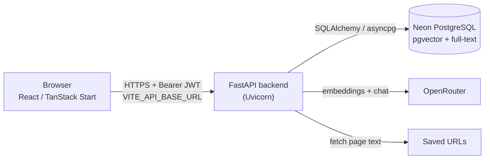

# AI Knowledge Inbox

A multi-user knowledge manager and source-grounded AI research assistant. Save notes and web pages, then ask questions in plain language. Answers are generated only from your saved material, and each answer lists the saved sources that support it.

## Live demo

| | |
|---|---|
| Frontend (Vercel) | <https://ai-knowledge-inbox-theta.vercel.app> |
| Backend API (Railway) | <https://ai-knowledge-inbox-production.up.railway.app> (interactive docs at `/docs`, liveness at `/health`) |
| Source code | <https://github.com/krishnakumar51/ai-knowledge-inbox> |
| Demo video (Loom) | <https://www.loom.com/share/94008f975c264c2baffe85d227a9966d> |

The deployment uses OpenRouter's free models, which have daily rate limits. If the limit is reached, questions return an error until it resets.

## How it works

1. **Save.** You create an account and add a note (title, content, optional date and optional source link) or a URL. For a URL, the backend fetches the page and extracts its main text.
2. **Process.** The text is split into overlapping chunks. Each chunk gets a 2048-dimension embedding from OpenRouter and is stored in PostgreSQL with pgvector.
3. **Ask.** You ask a question in a conversation. The backend retrieves the most relevant chunks from your own notes only, applying the three kinds of context below.
4. **Answer with sources.** The chat model writes an answer from those chunks. Each answer shows the saved notes that support it, with markers in the text that match the source list. The answer and its sources are saved with the conversation.

### Retrieval: three kinds of context

- **Content relevance.** Vector similarity (pgvector) and PostgreSQL full-text search are combined with Reciprocal Rank Fusion. A relevance threshold drops weak matches.
- **Source context.** If a question names a project or topic, retrieval is limited to the notes about it, using note titles and metadata. This keeps answers about one project from mixing in unrelated notes. Each answer is then checked against its sources, and only notes that support it are listed.
- **Temporal and metadata context.** A note can carry an `effective_at` date, meaning when the information applies. The question is parsed for wording such as "current", "as of 5 November", "in March" or "timeline". The system then filters and orders notes by those dates, so it prefers the latest applicable version and can reconstruct what was true at a past date. Dates are interpreted in `APP_TIMEZONE`.

## Key features

**Implemented**


- **Notes and URLs.** Save a note, or give a URL and the backend fetches the page and extracts its text.
- **Chunking and embeddings.** Content is split into overlapping chunks and embedded (2048-dimension vectors in pgvector).
- **Hybrid retrieval.** Vector similarity (pgvector) and PostgreSQL full-text search are fused with Reciprocal Rank Fusion. If a question names a project, retrieval is scoped to that project's notes. A relevance gate drops weak matches.
- **RAG question answering.** The chat model answers from the retrieved chunks only. If your notes don't cover a question, it says so.
- **Source citations.** Each answer carries its own list of supporting saved notes, with inline `[n]` markers that match the source rows. The list is stored with the message and comes back when you reload the conversation.
- **Conversations.** Persistent history, automatic titles, rename, delete. Earlier turns clarify follow-ups but are never treated as evidence.
- **Temporal retrieval.** A note can carry an `effective_at` date, meaning when the information applies. Questions such as "what is the current budget", "as of 5 November" or "show the timeline" are answered against the right dates (interpreted in `APP_TIMEZONE`).
- **Revision history.** Each edit is snapshotted and any revision can be restored. Items can be archived, and archived items are not retrieved.
- **Accounts and isolation.** Email and password registration, JWT bearer auth. Every item, chunk, conversation and query is scoped to its owner in SQL.

## Architecture



| Layer | Technology |
|---|---|
| Frontend | React 19, TypeScript, TanStack Start / Router, Vite (with Nitro for server rendering), Tailwind CSS 4, shadcn/Radix UI. Bun lockfile |
| Backend | Python 3.12, FastAPI, SQLAlchemy 2.0 (async), Pydantic v2, Alembic |
| Database | Neon PostgreSQL with pgvector (2048-dimension embeddings) and PostgreSQL full-text search |
| AI | OpenRouter as the model gateway. Chat model `openrouter/free` and embedding model `nvidia/nemotron-3-embed-1b:free` by default, both configurable |
| Hosting | Vercel (frontend), Railway (backend, Docker), Neon (database) |

Embeddings are generated by calling the OpenRouter API; no embedding model runs on the backend itself. `openrouter/free` is a routing alias, so the model that actually answers can change.

The browser talks only to the backend. The OpenRouter key and database credentials exist only in the backend environment.

### Data and storage

- **Accounts and ownership.** Every item, chunk, conversation and message belongs to a user and is filtered by `user_id` in SQL.
- **Items and chunks.** An item is a saved note or URL, with title, content, optional `effective_at`, metadata and a status (active, archived and so on). Its text is split into chunks, each holding a 2048-dimension vector. An approximate-nearest-neighbour index speeds up search.
- **Revisions.** Edits are snapshotted so any earlier revision can be restored.
- **Conversations.** Messages are stored separately from knowledge items. Each assistant message stores its own list of cited sources.

## Project structure

```
backend/
  app/
    api/routes/     auth, ingest, items, query, conversations, health
    services/       ingestion, chunking, embeddings, retrieval, scope, generation, titles
    providers/      OpenRouter client (chat + embeddings)
    models/ schemas/ core/ db/
  alembic/          migrations 0001-0004
  scripts/          data import and evaluation helpers (these call the live API)
  testdata/         sample datasets
  tests/            automated tests (no network)
  Dockerfile  railway.json  requirements.txt  .env.example
frontend/
  src/api/client.ts            typed API client
  src/components/              the app UI
  src/routes/                  TanStack routes
  vite.config.ts  package.json  bun.lock  .env.example
docker-compose.yml             optional local Postgres + API
```

## Local development (Windows)

Prerequisites: Python 3.12, [Bun](https://bun.sh) (or Node 22+), and a PostgreSQL database with the pgvector extension (a free Neon project works).

**Backend**

```powershell
cd backend
py -3.12 -m venv .venv
.\.venv\Scripts\Activate.ps1
python -m pip install -r requirements.txt
Copy-Item .env.example .env      # then edit .env (see Environment variables)
python -m alembic upgrade head
python -m uvicorn app.main:app --reload --port 8000
```

API docs are at <http://localhost:8000/docs>. If Windows Application Control blocks SQLAlchemy's optional `.pyd` files, install it from source with `$env:DISABLE_SQLALCHEMY_CEXT=1; pip install --no-binary=sqlalchemy "SQLAlchemy>=2.0,<2.1"`.

**Frontend**

```powershell
cd frontend
bun install
Copy-Item .env.example .env.local   # VITE_API_BASE_URL=http://localhost:8000
bun run dev -- --port 5173
```

Open <http://localhost:5173>. The backend's `CORS_ORIGINS` must include that exact origin (the example file already lists `http://localhost:5173` and `http://localhost:3000`).

## Environment variables

### Backend (`backend/.env`, or the host's variables). All private.

| Variable | Default | Purpose |
|---|---|---|
| `DATABASE_URL` | none (required) | PostgreSQL URL. `postgresql://` and `postgresql+asyncpg://` are both accepted. Use `sslmode=require` or `ssl=require`. `channel_binding` is rejected. |
| `JWT_SECRET_KEY` | none (required) | Signing secret, at least 32 random characters. |
| `JWT_EXPIRE_MINUTES` | `60` | Token lifetime (max 1440). |
| `JWT_ISSUER` | `ai-knowledge-inbox` | Token issuer. |
| `OPENROUTER_API_KEY` | none (required) | OpenRouter key. |
| `OPENROUTER_BASE_URL` | `https://openrouter.ai/api/v1` | |
| `OPENROUTER_CHAT_MODEL` | `openrouter/free` | Chat model. |
| `OPENROUTER_EMBEDDING_MODEL` | `nvidia/nemotron-3-embed-1b:free` | Embedding model. |
| `EMBEDDING_DIMENSIONS` | `2048` | Must match the database column. Don't change it without a migration and re-embedding. |
| `OPENROUTER_TIMEOUT_SECONDS`, `OPENROUTER_TEMPERATURE` | `45`, `0.2` | Request timeout and sampling temperature. |
| `CHUNK_SIZE`, `CHUNK_OVERLAP` | `800`, `120` | Chunking (overlap must be smaller than size). |
| `RETRIEVAL_TOP_K`, `RETRIEVAL_MIN_SCORE` | `5`, `0.15` | Retrieval size and minimum cosine similarity. |
| `RETRIEVAL_RELEVANCE_MARGIN` | `0.12` | How far below the best match a vector hit may fall. |
| `APP_TIMEZONE` | `Asia/Kolkata` | IANA zone for dates in answers and API responses. |
| `CORS_ORIGINS` | `["http://localhost:3000"]` | **JSON list** of allowed frontend origins. |
| `APP_NAME`, `APP_ENV`, `LOG_LEVEL`, `LLM_PROVIDER` | see `.env.example` | `LLM_PROVIDER` only accepts `openrouter`. |
| `MIGRATION_OWNER_EMAIL`, `MIGRATION_OWNER_PASSWORD_HASH` | empty | Only for migrating a database that already has ownerless items. |

### Frontend (public: baked into the browser bundle at build time)

| Variable | Purpose |
|---|---|
| `VITE_API_BASE_URL` | Backend origin, for example `https://your-service.up.railway.app`, with no trailing slash. Falls back to `http://localhost:8000` if unset. |

Never put the OpenRouter key, database URL or JWT secret in any frontend variable.

## Database setup

1. Create a Neon project and copy its **direct** (non-pooled) connection string. pgvector is available on Neon, and the first migration runs `CREATE EXTENSION IF NOT EXISTS vector`.
2. Set `DATABASE_URL` in the backend environment.
3. From `backend/`, run `python -m alembic upgrade head`. This is not run automatically on deploy. Run it once locally against the production URL, or use `railway run python -m alembic upgrade head`.
4. Check readiness with `GET /health/db`. It reports PostgreSQL, pgvector, the expected tables and the vector dimension, and never prints the connection string.

For a local Postgres, `docker compose up db` uses `pgvector/pgvector:pg16`. Copy `backend/.env.example` to the repository root as `.env` first (see the Compose variables in that file).

## Deployment

Order: **database → backend → frontend → backend CORS update.**

### 1. Neon

Create the database and run the migrations as described above. Back up or branch the database before migrating one that holds data.

### 2. Backend on Railway

The service builds `backend/Dockerfile`. It listens on `$PORT` and trusts proxy headers. `backend/railway.json` sets the Dockerfile builder and the `/health` check.

1. New Project → Deploy from GitHub repo → select this repository.
2. Service → Settings → **Root Directory** = `backend`. The builder is the Dockerfile, and the start command is already in it (`uvicorn app.main:app --host 0.0.0.0 --port ${PORT}`), so leave the custom start command empty.
3. Settings → Deploy → **Healthcheck Path** = `/health` (already in `railway.json`).
4. Variables: `DATABASE_URL`, `JWT_SECRET_KEY` (a new production secret), `OPENROUTER_API_KEY`, `OPENROUTER_BASE_URL`, `OPENROUTER_CHAT_MODEL`, `OPENROUTER_EMBEDDING_MODEL`, `EMBEDDING_DIMENSIONS=2048`, `APP_TIMEZONE`, `APP_ENV=production`, `LOG_LEVEL`, and `CORS_ORIGINS`. Set `CORS_ORIGINS` to a JSON list with only your deployed frontend origin, for example `["https://your-app.vercel.app"]`. Don't add `localhost` entries to production, and use no wildcard or trailing slash.
5. Settings → Networking → **Generate Domain**. That public URL is what the frontend uses.
6. Confirm `https://<railway-domain>/health` returns `{"status":"ok"}`, then `/health/db`.

### 3. Frontend on Vercel

The frontend is TanStack Start with Nitro (server-side rendering), not a static SPA. `vite.config.ts` selects Nitro's `vercel` preset when Vercel's `VERCEL` variable is present. Other builds keep the existing Cloudflare default.

1. Add New → Project → import the GitHub repository.
2. **Root Directory** = `frontend`. **Framework Preset** = Other (Nitro writes the Build Output directly, so leave the Output Directory empty). Vercel installs from `bun.lock`.
3. Install command `bun install`, build command `bun run build`. Use Node 22 or newer.
4. Environment variable (Production and Preview): `VITE_API_BASE_URL=https://<railway-domain>`.
5. Deploy. Because the variable is read at build time, redeploy whenever it changes.

### 4. Finish CORS

Copy the final Vercel origin (and any custom domain) into Railway's `CORS_ORIGINS`, then let Railway redeploy or restart. Preview deployments use different origins, so add one only if you test against it.

### Deployment checklist

Before deploying
- [ ] `git status` shows no `.env` files, and `working-docs/` is not staged.
- [ ] Neon is migrated (`alembic upgrade head`) and `/health/db` is OK.
- [ ] Push to GitHub yourself.
- [ ] Railway service created with root `backend`, variables set, domain generated, `/health` is OK.

Vercel
- [ ] Project imported with root `frontend`, `VITE_API_BASE_URL` set to the Railway URL, deployed.
- [ ] Vercel origin added to Railway `CORS_ORIGINS` and Railway restarted.

Final verification (manual; it uses OpenRouter quota)
- [ ] Register or sign in.
- [ ] Save a note.
- [ ] Ask a question and check the answer lists its sources.
- [ ] Reload the conversation and confirm the messages and sources persist.
- [ ] Sign in as a second account and confirm it sees none of the first account's data.

## API overview

All `/api/v1` routes except register and login need `Authorization: Bearer <token>`. Interactive docs are at `/docs` on a running backend. Errors have the shape `{"error": {"code", "message"}}`.

| Area | Routes |
|---|---|
| Auth | `POST /auth/register`, `POST /auth/login`, `GET /auth/me`, `PATCH /auth/me` (display name) |
| Ingest | `POST /ingest`. A note takes `{source_type:"note", title, content, effective_at?, metadata?}`. A URL takes `{source_type:"url", url, ...}`. `effective_at` needs a timezone offset. |
| Items | `GET /items`, `GET/PATCH/DELETE /items/{id}`. Changed content is re-chunked and re-embedded. |
| History | `GET /items/{id}/history`, `GET /items/{id}/history/{revision_id}`, `POST /items/{id}/restore/{revision_id}` |
| Query | `POST /query`, a stateless question that returns the answer and its sources |
| Conversations | `POST/GET /conversations`, `GET/PATCH/DELETE /conversations/{id}`, `POST /conversations/{id}/messages` |
| Health | `GET /health` (liveness), `GET /health/db`, `GET /health/ai` (configuration only), `POST /health/ai/test` (authenticated, makes a real provider call) |

## Testing

Automated, with no network or AI calls (from `backend/`, venv active):

```powershell
ruff check app tests alembic scripts
python -m compileall -q app alembic tests scripts
pytest
```

Frontend (from `frontend/`): `bun run lint`, `bunx tsc --noEmit`, `bun run build`. `bun run test` (Vitest) is configured, but it did not run in the maintainer's Windows environment, so treat it as unverified.

Live checks, which call OpenRouter and use quota, are manual only: `POST /health/ai/test`, `scripts/evaluate_temporal_queries.py`, `scripts/evaluate_atlas_temporal.py`, and the ingest and import scripts.

## Security notes

- Secrets are read only from the backend's environment. `.env` files are git-ignored, and only `.env.example` files are tracked.
- Passwords are hashed with scrypt (minimum 12 characters). JWTs are signed with `JWT_SECRET_KEY` and have an expiry.
- Every query filters by `user_id` in SQL, so one account cannot read another's items, chunks or conversations.
- CORS allows only the listed origins. In production, use the exact deployed frontend origin.
- Database errors are returned without driver details or connection strings.
- The frontend keeps its token in `sessionStorage`, and answers are rendered as Markdown without raw HTML.

## Limitations and possible future improvements

These are genuine current limitations. Anything marked *improvement* is an idea, not implemented and not a commitment.

- Depends on external services: OpenRouter for embeddings and chat, and a hosted PostgreSQL. It does not run offline.
- Free OpenRouter models have daily and per-minute limits. When they are exhausted, the API returns an error instead of an answer. `openrouter/free` is a router, so the model behind it can change.
- Registration is open, and there is no login rate limiting. *Improvement:* an invite-only mode and rate limiting.
- Source attachment uses word overlap between the answer and each chunk. Thresholds are untuned against live traffic, so a heavily paraphrased answer can miss a source.
- Source rows are one per saved note, even when several chunks of it were used.
- URL ingestion extracts text from static HTML only (no JavaScript rendering, no PDFs). *Improvement:* PDF and file upload support.
- Migrations are run manually, not on deploy. *Improvement:* an automated migration step in the release process.
- There is no screenshot gallery in this README yet.

## Project status

The features listed under **Implemented** are built, and the backend has automated tests that run without network access. The application is deployed (links above). The AI-dependent paths (live answers, source-matching thresholds, temporal evaluation) depend on OpenRouter quota and have been checked manually rather than by automated tests.
